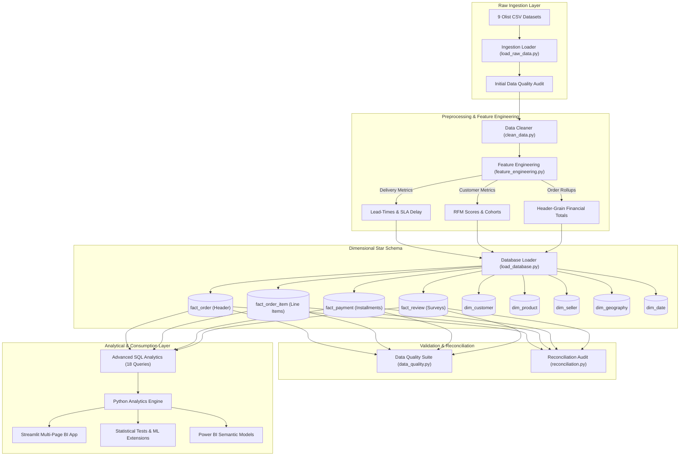

# System Architecture & Technical Design

## 1. Architectural Blueprint
The E-Commerce Business Intelligence & Analytics platform is designed as an end-to-end analytics engineering pipeline supporting both relational PostgreSQL deployment and local high-performance embedded analytical storage (DuckDB).

---

## 2. Dimensional Data Modeling Strategy (Kimball Methodology)
A core challenge with e-commerce transaction data is the risk of **Cartesian fan-out**: joining line items, payments, and reviews directly to an order record duplicates financial totals and introduces severe aggregation errors.

### The Solution: Granularity Separation
1. **Header Grain (`fact_order`):**
   - Grain: Exactly 1 row per order.
   - Pre-aggregated order financial totals (`merchandise_value`, `freight_value`, `total_order_value`, `total_payment_value`).
   - Pre-computed logistics lead-times (`delivery_duration_days`, `delivery_delay_days`, `is_delivered_on_time`).
2. **Line Item Grain (`fact_order_item`):**
   - Grain: 1 row per physical product item within an order.
   - Composite Primary Key: `(order_id, order_item_id)`.
3. **Payment Grain (`fact_payment`):**
   - Grain: 1 row per installment payment sequence.
   - Composite Primary Key: `(order_id, payment_sequential)`.
4. **Survey Feedback Grain (`fact_review`):**
   - Grain: 1 row per survey submission.
   - Composite Primary Key: `(review_id, order_id)`.

---

## 3. Resilient Database Engine & Dual Backend
The database connection abstraction in `src/database/connection.py` provides resilient connectivity:
- **Production Mode:** Connects to PostgreSQL 16+ via SQLAlchemy 2.0 and `psycopg` (v3 binary driver) using environment credentials from `.env`.
- **Embedded Analytics Mode:** Automatically falls back to DuckDB columnar storage if PostgreSQL is offline or if `DB_BACKEND=duckdb` is specified. DuckDB executes the exact same ANSI SQL DDL, window functions, and views with sub-millisecond query latency directly against local disk storage (`data/processed/ecommerce_bi.duckdb`).

---

## 4. Performance Optimizations
1. **Vectorized Transformations:** All cleaning and feature engineering steps utilize NumPy and Pandas vectorized datetime and numerical operations.
2. **Columnar Indexing & Storage:** In PostgreSQL, B-tree indexes are established on all primary and foreign keys (`order_purchase_date_id`, `customer_id`, `product_id`, `seller_id`).
3. **Session Caching:** Streamlit caching (`@st.cache_data`) stores pre-aggregated dataframes, preventing redundant disk I/O on UI filter adjustments.
4. **Pre-Aggregated Analytical Views:** `vw_order_summary`, `vw_monthly_sales`, and `vw_seller_kpis` materialize common multi-table join paths.

---

## 5. Security & Idempotency
- **Zero Committed Secrets:** Credentials are read strictly from environment variables via `python-dotenv`.
- **Pipeline Idempotency:** The ETL pipeline can be executed repeatedly (`python -m src.database.load_database`) without corrupting tables or creating duplicate records.
- **Data Quality Gatekeeping:** The pipeline terminates or alerts when critical schema, uniqueness, or referential constraints fail.
