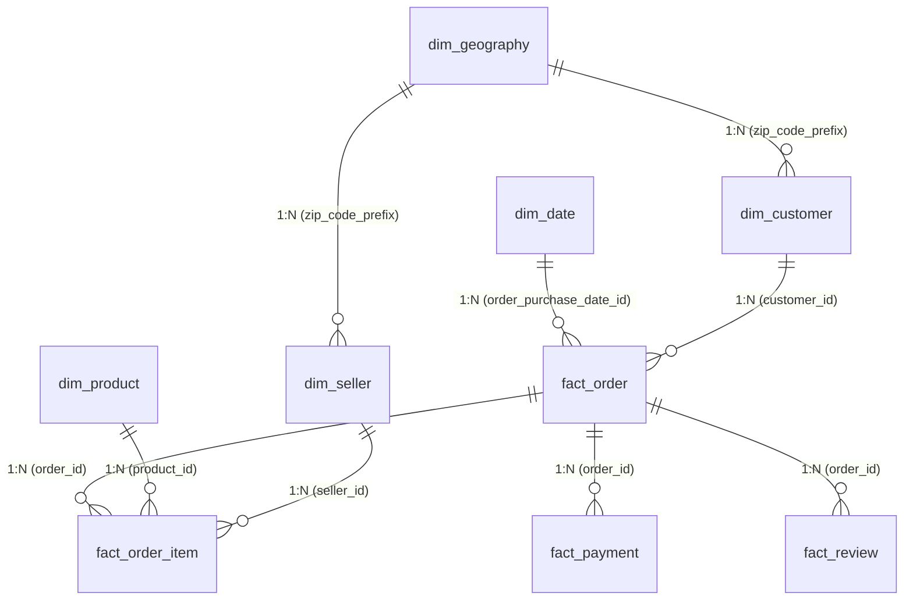

# Power BI Analytical Data Model Specification

## 1. Architectural Overview
The Power BI analytical model is implemented as a canonical Kimball Star Schema. It mirrors the relational PostgreSQL/DuckDB production database, decoupling transaction grains to prevent Cartesian fan-out errors.

---

## 2. Table Granularities & Cardinality

| Table Name | Type | Primary Key (PK) | Business Grain | Foreign Keys (FK) |
| :--- | :--- | :--- | :--- | :--- |
| `fact_order` | Fact (Header) | `order_id` | Exactly 1 row per purchase order | `customer_id`, `order_purchase_date_id` |
| `fact_order_item` | Fact (Line Item) | `(order_id, order_item_id)` | 1 row per physical product line | `order_id`, `product_id`, `seller_id` |
| `fact_payment` | Fact (Financial) | `(order_id, payment_sequential)` | 1 row per installment payment | `order_id` |
| `fact_review` | Fact (Feedback) | `(review_id, order_id)` | 1 row per customer review survey | `order_id` |
| `dim_date` | Dimension | `date_id` (YYYYMMDD) | 1 row per calendar day | None |
| `dim_customer` | Dimension | `customer_id` | 1 row per order-level customer token | `customer_zip_code_prefix` |
| `dim_product` | Dimension | `product_id` | 1 row per unique product SKU | None |
| `dim_seller` | Dimension | `seller_id` | 1 row per merchant / vendor | `seller_zip_code_prefix` |
| `dim_geography` | Dimension | `zip_code_prefix` | 1 row per Brazilian postal centroid | None |

---

## 3. Storage Mode & Relationship Filtering Rules
1. **Cross-Filtering Direction:** Single direction from Dimension (1) to Fact (N). Bi-directional cross-filtering is strictly avoided to preserve index performance and prevent ambiguous filter propagation.
2. **Cardinality Configuration:** 
   - `dim_date[date_id]` (1) -> `fact_order[order_purchase_date_id]` (Many)
   - `dim_customer[customer_id]` (1) -> `fact_order[customer_id]` (Many)
   - `fact_order[order_id]` (1) -> `fact_order_item[order_id]` (Many)
   - `dim_product[product_id]` (1) -> `fact_order_item[product_id]` (Many)
   - `dim_seller[seller_id]` (1) -> `fact_order_item[seller_id]` (Many)
3. **Storage Mode:** Import Mode or DirectQuery to PostgreSQL/DuckDB ODBC connector.
